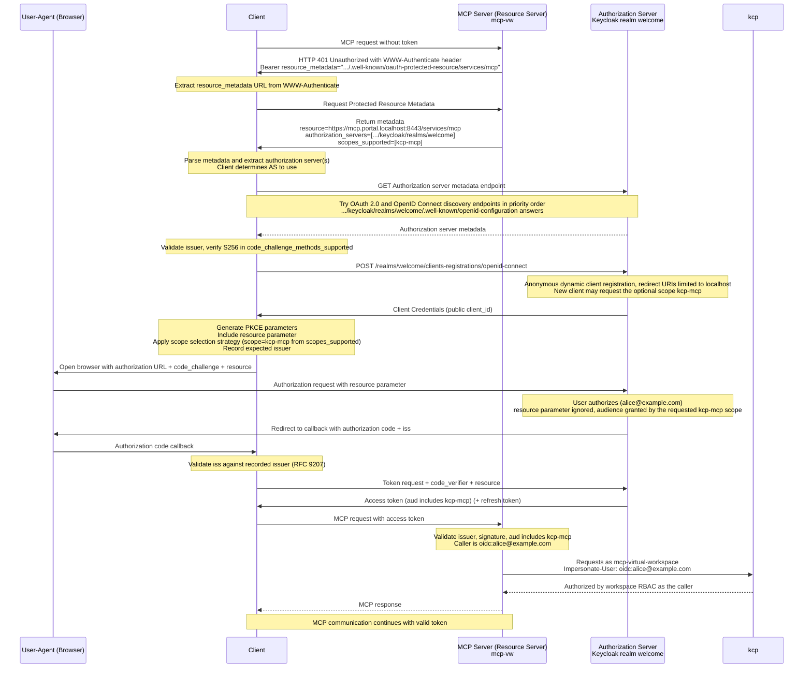
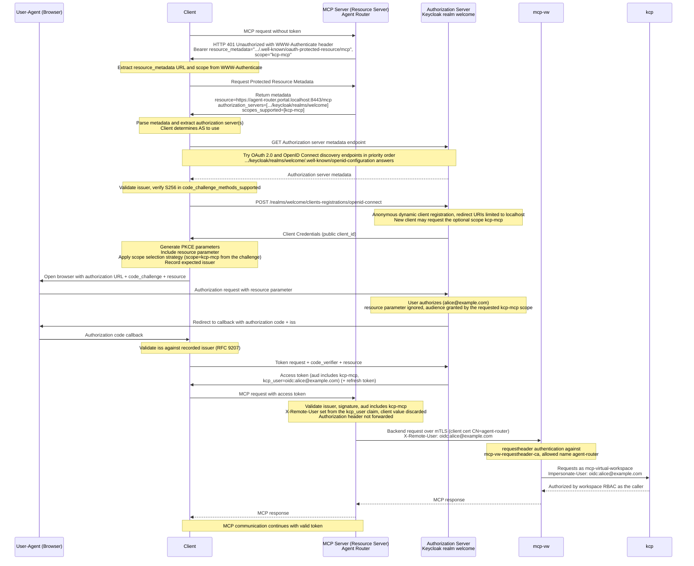

# Authorization flows

How an MCP client gets authorized in each setup, drawn after the
[authorization flow diagram](https://modelcontextprotocol.io/specification/2026-07-28/basic/authorization#authorization-flow-steps)
in the MCP authorization spec (2026-07-28). The participants keep the spec's
roles:

| Spec role | Setup 1 | Setup 2 |
| --- | --- | --- |
| Client | MCP client, e.g. Copilot Chat | same |
| MCP Server (Resource Server) | mcp-vw at `https://mcp.portal.localhost:8443/services/mcp` | Agent Router at `https://agent-router.portal.localhost:8443/mcp` |
| Authorization Server | Keycloak, realm `welcome` (`https://portal.localhost:8443/keycloak/realms/welcome`) | same |

Two participants are added: mcp-vw as the router's backend in Setup 2, and
kcp, which both setups call with impersonation. Client registration uses
dynamic client registration, the one mechanism these setups support. Client ID
Metadata Documents are left out because Keycloak does not support them yet.

## Setup 1: direct

Traefik terminates TLS and forwards to mcp-vw. mcp-vw serves the protected
resource metadata and validates bearer tokens itself.

## Setup 2: behind the Agent Router

The Agent Router is the resource server the client sees. It serves the
protected resource metadata, validates the token and asserts the caller's
identity to mcp-vw with requestheader authentication over mutual TLS. The
bearer token is not forwarded past the router.

